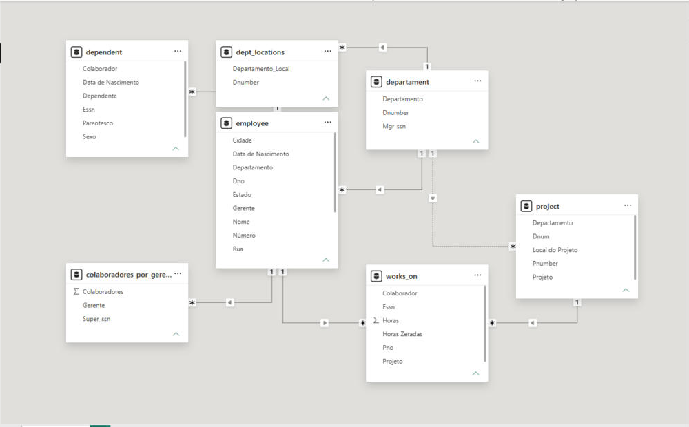
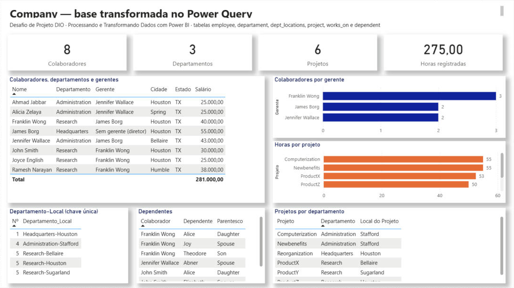
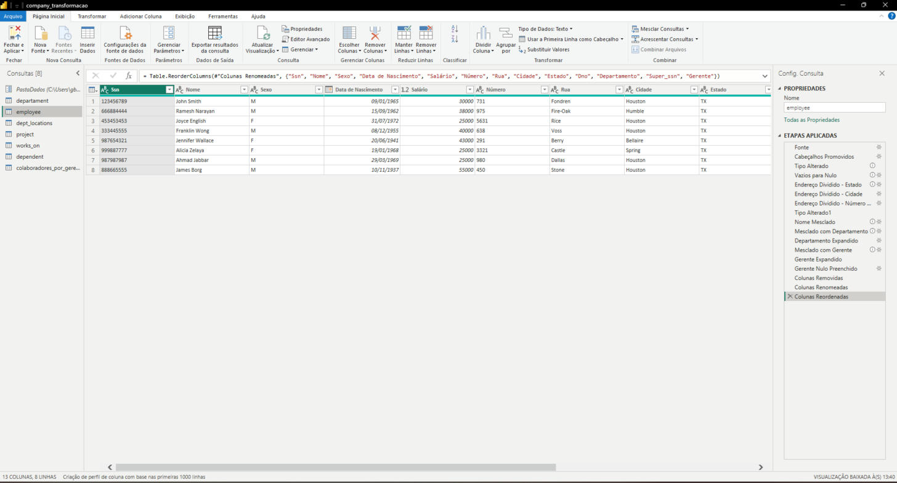

# Desafio de Projeto DIO — Processando e Transformando Dados com Power BI

Terceiro desafio de projeto da formação **Power BI Analyst** da [DIO](https://www.dio.me/): integrar o banco de dados `company` ao Power BI e tratar os dados no Power Query seguindo as diretrizes do desafio (tipos, nulos, colunas complexas, mesclas, agrupamento e limpeza de colunas).

## Arquivos

| Pasta / arquivo | Conteúdo |
|---|---|
| `company_transformacao.pbix` | Relatório do Power BI com as sete consultas transformadas e uma página de verificação |
| `sql/` | Scripts originais do curso: criação do banco `company` e inserção dos dados |
| `dados/` | As seis tabelas do banco exportadas em CSV (fonte usada pelo Power Query) |
| `power-query/` | Código M de cada consulta, uma etapa por linha, como aparece no Editor Avançado |
| `prints/` | Relatório, etapas aplicadas no Power Query e modelo de relacionamentos |

## Fonte de dados

O enunciado prevê uma instância de MySQL no Azure. Neste repositório o banco foi recriado localmente a partir dos scripts do curso (`sql/script_bd_company.sql` e `sql/insercao_de_dados_e_queries_sql.sql`) e as seis tabelas foram exportadas em CSV (`dados/`). O Power BI lê os CSV por meio do parâmetro `PastaDados`, que aponta para a pasta com os arquivos.

Para apontar o mesmo relatório para um MySQL (no Azure ou local), basta trocar a etapa **Fonte** de cada consulta por:

```m
Fonte = MySQL.Database("servidor.mysql.database.azure.com", "azure_company", [ReturnSingleDatabase=true]){[Schema="azure_company", Item="employee"]}[Data]
```

Todas as etapas seguintes continuam iguais, porque elas só dependem dos nomes das colunas.

Duas observações sobre os scripts do curso, que vale conhecer antes de rodá-los no MySQL:

- O script de criação usa o schema `azure_company`, mas o script de inserção começa com `use company_constraints;`. É preciso usar o mesmo schema nos dois.
- O `INSERT` de `employee` referencia gerentes que ainda não existem (por exemplo, Franklin Wong aponta para James Borg, inserido depois). Como há chave estrangeira `Super_ssn → Ssn`, o MySQL rejeita a inserção. Solução: inserir James Borg primeiro ou executar `SET FOREIGN_KEY_CHECKS = 0;` antes do `INSERT`.

## Verificação da base

Antes de transformar, os dados foram conferidos. O que apareceu:

| Verificação | Resultado |
|---|---|
| Cabeçalhos e tipos | Chegam todos como texto; `Salary` e `Hours` precisam virar número, `Bdate`/`Mgr_start_date`/`Dept_create_date` precisam virar data, `Dnumber`/`Dno`/`Pnumber`/`Pno`/`Dnum` precisam virar inteiro |
| Nulos | Só `employee.Super_ssn` tem um nulo: **James Borg**, diretor em Headquarters. Não é erro, é o topo da hierarquia, então a linha foi mantida |
| Colaborador sem gerente | Apenas James Borg (ver acima). No relatório ele aparece como "Sem gerente (diretor)" |
| Departamento sem gerente | Nenhum: Research → Franklin Wong, Administration → Jennifer Wallace, Headquarters → James Borg. Como não houve lacuna, não foi preciso preencher nada |
| Horas dos projetos | Nenhum nulo ou valor negativo. Um registro com **0 h** (James Borg em Reorganization) foi mantido e sinalizado na coluna `Horas Zeradas`. Totais: Computerization 55, Newbenefits 55, ProductX 52,5, ProductZ 50, ProductY 37,5, Reorganization 25 |
| Coluna complexa | `Address` concentra número, rua, cidade e estado em um texto só (`731-Fondren-Houston-TX`) |

## Transformações, consulta por consulta

Os nomes abaixo são os das etapas aplicadas no Power Query (`prints/power-query-employee.png` mostra a lista completa de `employee`).

### departament

1. **Cabeçalhos Promovidos** e **Tipo Alterado**: `Dname` texto, `Dnumber` inteiro, `Mgr_ssn` texto, datas como data.
2. **Vazios para Nulo** em `Mgr_ssn`, para que um departamento sem gerente aparecesse como nulo. Não havia nenhum.
3. **Colunas Removidas**: `Mgr_start_date` e `Dept_create_date` não entram no relatório.
4. **Colunas Renomeadas**: `Dname` → `Departamento`.

### employee

1. **Tipo Alterado**: `Salary` para **Número Decimal** (`type number`, ponto flutuante de precisão dupla, como pede o desafio); `Bdate` para data; `Dno` para inteiro; `Ssn` e `Super_ssn` ficam como texto, porque são identificadores, não quantidades.
2. **Vazios para Nulo** em `Minit` e `Super_ssn`.
3. **Endereço dividido em três etapas**: `Address` é dividido pelo delimitador `-` **mais à direita** duas vezes (sai `Estado`, depois `Cidade`) e pelo delimitador **mais à esquerda** uma vez (sai `Número`). O que sobra é a `Rua`. Essa ordem é necessária porque uma rua tem hífen no nome (`975-Fire-Oak-Humble-TX` → 975 / Fire-Oak / Humble / TX); dividir por todos os hífens de uma vez quebraria essa linha.
4. **Nome Mesclado**: `Fname` e `Lname` mesclados com espaço em uma única coluna `Nome`.
5. **Mesclado com Departamento**: mescla de `employee` (tabela base) com `departament` por `Dno = Dnumber`, **junção externa esquerda**. A base ser `employee` define o tipo de junção: a externa esquerda mantém todos os colaboradores mesmo que algum esteja sem departamento, enquanto uma junção interna descartaria essas linhas. Expandida só a coluna `Departamento`.
6. **Mesclado com Gerente**: junção do colaborador com o nome do gerente. Feita no próprio Power Query, mesclando a tabela com ela mesma (`Super_ssn = Ssn`, externa esquerda) e expandindo `Nome` como `Gerente`. A etapa usa a versão da consulta logo após "Nome Mesclado" como lado direito, o que evita referência circular.
7. **Gerente Nulo Preenchido**: o nulo de James Borg vira "Sem gerente (diretor)".
8. **Colunas Removidas** (`Minit`), **Colunas Renomeadas** (`Sex` → `Sexo`, `Bdate` → `Data de Nascimento`, `Salary` → `Salário`) e **Colunas Reordenadas**.

A mesma junção com os gerentes, se fosse feita em SQL, seria:

```sql
SELECT  e.Ssn,
        CONCAT(e.Fname, ' ', e.Lname)            AS Nome,
        d.Dname                                   AS Departamento,
        e.Super_ssn,
        COALESCE(CONCAT(m.Fname, ' ', m.Lname),
                 'Sem gerente (diretor)')         AS Gerente
FROM employee e
LEFT JOIN departament d ON d.Dnumber = e.Dno
LEFT JOIN employee    m ON m.Ssn     = e.Super_ssn;
```

### dept_locations

1. **Tipo Alterado**: `Dnumber` inteiro, `Dlocation` texto.
2. **Mesclado com Departamento** (externa esquerda por `Dnumber`) e **Departamento Expandido**: traz o nome do departamento para cada localização.
3. **Departamento-Local Mesclado**: `Departamento` e `Dlocation` mesclados com `-` em `Departamento_Local`. Cada combinação vira única (Research-Bellaire, Research-Sugarland, Research-Houston, Administration-Stafford, Headquarters-Houston), o que serve de chave para o modelo estrela do próximo módulo.

**Por que mesclar e não acrescentar?** *Mesclar consultas* junta duas tabelas **lado a lado**, casando linhas por uma chave (aqui, `Dnumber`): cada linha de `dept_locations` recebe as colunas da linha correspondente de `departament`. *Acrescentar consultas* empilha tabelas **uma embaixo da outra**, somando linhas de tabelas com as mesmas colunas, sem relacionar nada. Como o objetivo é trazer o nome do departamento para a linha de cada localização, só a mescla resolve; o acréscimo apenas colocaria as três linhas de `departament` abaixo das cinco de `dept_locations`, com colunas que não combinam e sem nenhuma ligação entre elas.

### project

1. **Tipo Alterado**: `Pname` texto, `Pnumber` e `Dnum` inteiros, `Plocation` texto.
2. **Mesclado com Departamento** por `Dnum = Dnumber` e **Departamento Expandido**.
3. **Colunas Renomeadas**: `Pname` → `Projeto`, `Plocation` → `Local do Projeto`.

### works_on

1. **Tipo Alterado**: `Essn` texto, `Pno` inteiro, `Hours` **Número Decimal**.
2. **Horas Zeradas Sinalizadas**: coluna lógica que marca `Hours = 0`.
3. **Mesclado com Colaborador** (`Essn = Ssn`) e **Mesclado com Projeto** (`Pno = Pnumber`), expandindo `Nome` como `Colaborador` e `Projeto`.
4. **Colunas Renomeadas** (`Hours` → `Horas`) e **Colunas Reordenadas**.

### dependent

1. **Tipo Alterado**: `Essn` texto, `Bdate` data, demais texto.
2. **Mesclado com Colaborador** (`Essn = Ssn`), expandindo `Nome` como `Colaborador`.
3. **Colunas Renomeadas**: `Dependent_name` → `Dependente`, `Relationship` → `Parentesco`, `Sex` → `Sexo`, `Bdate` → `Data de Nascimento`.

### colaboradores_por_gerente

Consulta criada a partir de `employee`:

1. **Linhas Filtradas**: só colaboradores com `Super_ssn` preenchido (o diretor não tem gerente).
2. **Linhas Agrupadas**: agrupar por `Super_ssn` e `Gerente`, contando as linhas em `Colaboradores`.
3. **Linhas Classificadas**: ordem decrescente.

| Gerente | Colaboradores |
|---|---|
| Franklin Wong | 3 (John Smith, Ramesh Narayan, Joyce English) |
| Jennifer Wallace | 2 (Alicia Zelaya, Ahmad Jabbar) |
| James Borg | 2 (Franklin Wong, Jennifer Wallace) |

### Colunas removidas

Em cada tabela ficaram só as colunas usadas no relatório ou necessárias como chave: saíram `Minit` (employee), `Mgr_start_date` e `Dept_create_date` (departament) e as colunas originais `Fname`, `Lname`, `Address`, `Dname` e `Dlocation`, substituídas pelas colunas mescladas ou divididas.

## Modelo e relatório



Relacionamentos: `employee`, `dept_locations` e `project` → `departament`; `works_on` e `dependent` → `employee`; `works_on` → `project`; `colaboradores_por_gerente` → `employee`. O relacionamento `project → departament` ficou **inativo** para não criar dois caminhos entre `works_on` e `departament` (via `employee` e via `project`); `project` já carrega o nome do departamento pela mescla.



A página **Verificação da base** mostra os cartões (8 colaboradores, 3 departamentos, 6 projetos, 275 horas), a tabela de colaboradores com departamento, gerente, cidade, estado e salário, colaboradores por gerente, horas por projeto, a chave Departamento-Local, os dependentes e os projetos por departamento.



## Como abrir

1. Baixe `company_transformacao.pbix` e abra no Power BI Desktop. Os dados já estão carregados.
2. Para atualizar a partir dos CSV, baixe a pasta `dados/` e, em **Transformar dados > Gerenciar parâmetros**, aponte `PastaDados` para ela.
3. Para usar MySQL, troque a etapa **Fonte** de cada consulta como mostrado em *Fonte de dados*.

## Referência

Repositório do curso, com os scripts e os arquivos das aulas: [julianazanelatto/power_bi_analyst](https://github.com/julianazanelatto/power_bi_analyst)
